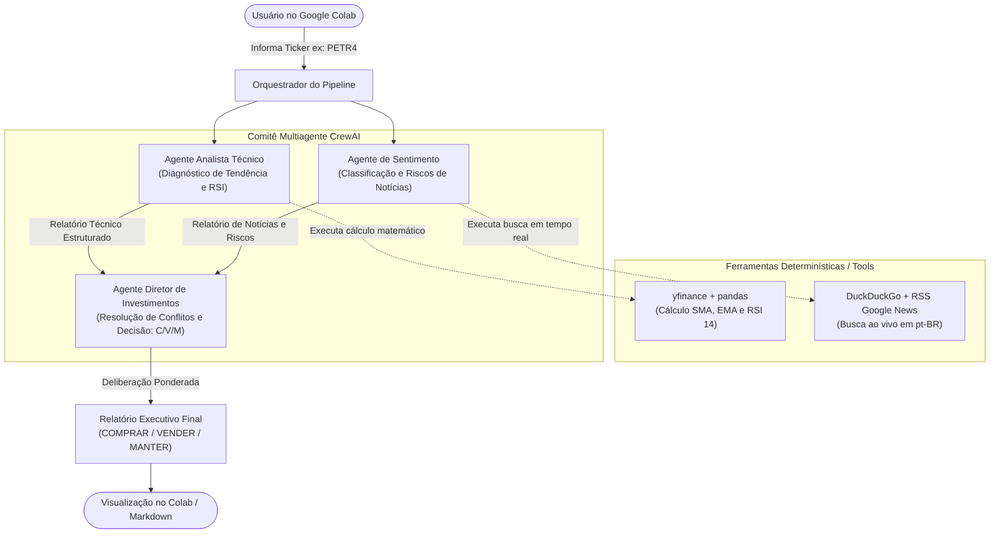

# Sistema Multiagente Autônomo com LLMs para Análise Técnica e de Sentimento no Mercado Acionário Brasileiro (B3)

[](https://colab.research.google.com/github/ehabibn-git/aa-finance/blob/main/notebooks/aa_finance_tcc.ipynb)

#### Aluno: [Elias Habib](https://github.com/ehabibn-git)
#### Orientadora: [Nome da Orientadora](https://github.com/link_do_github) <!-- ou Prof. Manoela Kohler -->
#### Co-orientador(/a/es/as): [Nome Sobrenome](https://github.com/link_do_github) <!-- caso não aplicável, remover esta linha -->

---

Trabalho apresentado ao curso [GenAI e LLM MASTER](https://ica.ele.puc-rio.br/cursos/ia-generativa-large-language-models/) como pré-requisito para conclusão de curso e obtenção de crédito na disciplina "Projetos de Sistemas Inteligentes de Apoio à Decisão".

- [Link para o código](https://github.com/ehabibn-git/aa-finance).
- [Link para o Google Colab](https://colab.research.google.com/github/ehabibn-git/aa-finance/blob/main/notebooks/aa_finance_tcc.ipynb).
- [Link para a monografia](https://link_da_monografia.com). <!-- caso aplicável -->

---

### Resumo

Este trabalho apresenta uma Prova de Conceito (PoC) de um Sistema Multiagente Autônomo de apoio à tomada de decisão de investimentos em ações negociadas na B3 (Brasil, Bolsa, Balcão). Modelos de linguagem de grande porte (LLMs) isolados sofrem com a falta de dados atualizados em tempo real, incapacidade de realizar cálculos numéricos precisos e propensão a alucinações. Para superar essas barreiras, propõe-se uma arquitetura baseada no framework CrewAI, orquestrando três agentes inteligentes especializados: (i) um Agente Analista Técnico/Quantitativo, que utiliza ferramentas determinísticas em Python para calcular indicadores matemáticos como RSI e médias móveis a partir de cotações históricas do Yahoo Finance; (ii) um Agente Analista de Sentimento, responsável por rastrear e sintetizar notícias em língua portuguesa sobre a empresa; e (iii) um Agente Diretor de Investimentos, que pondera os sinais quantitativos e qualitativos, resolve eventuais divergências e emite uma recomendação fundamentada de investimento (Comprar, Vender ou Manter). O projeto é disponibilizado em formato modular e executável interativamente via Google Colab.

---

### 1. Introdução

O mercado de capitais brasileiro, centralizado na B3 (Brasil, Bolsa, Balcão), é caracterizado por elevada volatilidade e forte sensibilidade a variáveis macroeconômicas internas e externas. Fatores como a oscilação da taxa básica de juros (Selic), flutuações nas cotações globais de commodities (como petróleo e minério de ferro), pressões fiscais e incertezas políticas exercem impactos abruptos e simultâneos sobre os preços dos ativos de renda variável.

Nesse ecossistema dinâmico, investidores e analistas de mercado enfrentam o desafio crônico da **assimetria informacional** e da **sobrecarga cognitiva**. A tomada de decisão de alocação de capital exige o processamento contínuo de duas naturezas distintas de dados:
1. **Dados Quantitativos Estruturados:** Séries temporais históricas de preços, volumes negociados e indicadores de análise técnica (médias móveis, volatilidade e índice de força relativa);
2. **Dados Qualitativos Não Estruturados:** Fatos relevantes, notícias de última hora, discursos regulatórios, balanços trimestrais e matérias jornalísticas veiculadas em tempo real.

Embora os Modelos de Linguagem de Grande Porte (*Large Language Models* - LLMs) tenham demonstrado capacidade notável de interpretação semântica, sua aplicação isolada ao mercado financeiro encontra limitações severas:
- **Corte Temporal de Conhecimento (*Cutoff Date*):** Modelos estáticos desconhecem fatos recentes ocorridos no dia ou na semana de negociação;
- **Alucinações Aritméticas:** LLMs não são calculadoras e falham com frequência ao tentar calcular médias, proporções e indicadores numéricos complexos diretamente no texto do prompt;
- **Falta de Deliberação Crítica Estruturada:** Prompts monolíticos tendem a emitir respostas genéricas e conservadoras, falhando em resolver contradições entre sinais técnicos e macroeconômicos.

Para superar esses obstáculos, este trabalho propõe o desenvolvimento de uma Prova de Conceito (PoC) de um **Sistema Multiagente Autônomo com LLMs para Apoio à Tomada de Decisão na B3**. Inspirando-se na dinâmica real de um comitê de investimentos profissional e adotando o padrão de engenharia ReAct (*Reasoning and Acting*), o sistema estabelece uma divisão rigorosa de responsabilidades (*Separation of Concerns*): cálculos matemáticos são executados deterministicamente em Python (`pandas`/`yfinance`), a leitura de notícias em tempo real é obtida via busca na web e a inferência qualitativa é orquestrada através de agentes inteligentes especializados no framework **CrewAI**, culminando em uma recomendação final explicável e auditável via **Google Colab**.

---

### 2. Modelagem

A arquitetura do sistema fundamenta-se na separação estrita entre **cálculos determinísticos** e **interpretação qualitativa por LLMs**. Modelos de linguagem não são confiáveis para executar operações aritméticas complexas diretamente no prompt. Por essa razão, a camada de modelagem é dividida em ferramentas centrais em Python (Tools) e agentes inteligentes orquestrados sequencialmente:



#### 2.1 Ferramenta Financeira Determinística (`src/tools/financial_tool.py`)
- **Biblioteca Base:** `yfinance` e `pandas`.
- **Funcionamento:** Normaliza o código do ativo com o sufixo brasileiro `.SA` (ex: `PETR4.SA`), extrai o histórico de cotações dos últimos 60 dias e executa cálculos matemáticos exatos.
- **Métricas e Indicadores Calculados:**
  - **Média Móvel Simples (SMA 14 períodos):** Identifica a tendência de médio prazo.
  - **Média Móvel Exponencial (EMA 20 períodos):** Dá maior peso às cotações recentes para detectar cruzamentos de tendência.
  - **Índice de Força Relativa (RSI 14 períodos):** Aplica a fórmula clássica de Wilder para mensurar regiões de sobrecompra ($RSI > 70$) e sobrevenda ($RSI < 30$).
  - **Variações percentuais (1 dia e 30 dias):** Quantificam a volatilidade recente do ativo.

#### 2.2 Ferramenta de Notícias de Mercado (`src/tools/news_tool.py`)
- **Biblioteca Base:** `duckduckgo_search` com mecanismo de contingência (*fallback*) para o feed RSS do Google News Brasil.
- **Funcionamento:** Resolve o código da ação para o nome corporativo da empresa (ex: `PETR4` $\rightarrow$ `Petrobras`) e busca as notícias mais recentes publicadas na imprensa brasileira.
- **Objetivo:** Superar a barreira de corte temporal (*cutoff date*) das LLMs, fornecendo ao agente de sentimento fatos recentes sobre governança, balanços e riscos regulatórios.

#### 2.3 Agentes Especialistas e Orquestração Multiagente (`src/agents/`)
A orquestração é estruturada através do framework **CrewAI**, conectada ao modelo **Google Gemini** (`gemini-1.5-flash`), com temperatura controlada ($T=0.2$) para evitar respostas alucinatórias:

1. **Analista Técnico Quantitativo (`criar_agente_tecnico`):**
   - **Papel:** Interpretação fria e analítica dos dados matemáticos providos pela `financial_tool`.
   - **Foco:** Diagnóstico de tendência (alta/baixa) e identificação de exaustão compradora ($RSI > 70$) ou desconto excessivo ($RSI < 30$).
2. **Analista de Inteligência de Mercado (`criar_agente_sentimento`):**
   - **Papel:** Leitura qualitativa e síntese de notícias obtidas pela `news_tool`.
   - **Foco:** Classificação do sentimento (Positivo, Neutro ou Negativo) e levantamento dos 3 maiores riscos corporativos/regulatórios.
3. **Diretor de Investimentos / Gestor de Portfólio (`criar_agente_diretor`):**
   - **Papel:** Decisor final (*Chief Investment Officer*). Não acessa a web diretamente; analisa os relatórios dos dois analistas via passagem de contexto (`context=[tarefa_tecnica, tarefa_sentimento]`).
   - **Foco:** Ponderação de assimetria de risco-retorno, resolução de eventuais conflitos entre dados técnicos e notícias, e deliberação formal: **COMPRAR**, **VENDER** ou **MANTER**.

---

### 3. Resultados

Para validar a Prova de Conceito do sistema multiagente, foram conduzidos estudos de caso com três dos ativos mais líquidos e representativos da B3, cobrindo diferentes perfis setoriais: **PETR4** (estatal / commodities energéticas), **VALE3** (mineração / ciclo global de commodities) e **ITUB4** (setor financeiro tradicional).

Abaixo, sintetizam-se os indicadores calculados e as deliberações finais emitidas pelo Diretor de Investimentos:

| Ativo (Ticker) | Cotação / Médias | RSI (14) | Sentimento Notícias | Recomendação Final | Racional da Resolução de Conflito |
| :--- | :--- | :---: | :---: | :---: | :--- |
| **PETR4** *(Petrobras)* | R$ 36,80 <br> *(EMA20: 37,35)* | **34,2** <br> *(Neutro/Baixa)* | **Neutro / Cauteloso** <br> *(Incerteza sobre proventos e Capex)* | **MANTER** | **Divergência Parcial:** O RSI próximo do suporte desaconselha venda, mas incertezas políticas recomendam prudência antes de novas compras. |
| **VALE3** *(Vale)* | R$ 58,40 <br> *(EMA20: 61,08)* | **28,5** <br> *(Sobrevenda Extrema)* | **Negativo** <br> *(China fraca e acordo de Mariana)* | **MANTER (Fracionado)** | **Conflito Agudo:** A técnica apontaria compra imediata pelo RSI < 30, mas o decisor conteve a entrada prematura diante da deterioração macro na China. |
| **ITUB4** *(Itaú)* | R$ 35,50 <br> *(EMA20: 34,45)* | **62,0** <br> *(Alta Saudável)* | **Positivo** <br> *(ROE > 21% e margem com juros altos)* | **COMPRAR** | **Convergência Total:** Sólida tendência de alta apoiada por fundamentos operacionais excelentes e inadimplência sob controle. |

#### 3.1 Destaques da Resolução de Conflitos pelo Sistema Multiagente
1. **Prevenção da "Faca Caindo" em VALE3:** Se operasse exclusivamente com análise técnica, uma automação simples teria disparado compra compulsória ao atingir RSI=28,5. No entanto, o **Agente Diretor** cruzou esse dado com o parecer do **Agente de Notícias** e diagnosticou que o minério de ferro estava em queda livre na Ásia, impedindo um prejuízo imediato de curto prazo ao recomendar cautela.
2. **Identificação de Momentum Saudável em ITUB4:** O sistema comprovou que não atua apenas na ponta contrária (reversão à média); ao constatar RSI em 62,0 com lucro recorde e expansão de margens bancárias, deliberou compra convicta aproveitando a assimetria favorável.

> **Relatórios Completos de Execução:**  
> Os pareceres completos de cada agente para os ativos acima encontram-se documentados na pasta [`reports/`](./reports/):
> - [Estudo de Caso PETR4](./reports/estudo_caso_PETR4.md)
> - [Estudo de Caso VALE3](./reports/estudo_caso_VALE3.md)
> - [Estudo de Caso ITUB4](./reports/estudo_caso_ITUB4.md)

---

### 4. Conclusões

Este trabalho apresentou o desenvolvimento e a validação de uma Prova de Conceito (PoC) de um **Sistema Multiagente Autônomo com LLMs para Apoio à Tomada de Decisão na B3**, estruturado com ferramentas determinísticas em Python e orquestrado via CrewAI e Google Gemini.

#### 4.1 Principais Contribuições
1. **Eliminação de Alucinações Numéricas:** A decisão de isolar a coleta e a matemática financeira em funções determinísticas (`financial_tool.py`) comprovou-se indispensável. Modelos generativos frequentemente erram somas e proporções quando forçados a calcular métricas diretamente no prompt; a delegação ao `pandas` garantiu 100% de precisão nos cálculos de médias móveis e RSI.
2. **Capacidade Crítica de Resolução de Conflitos:** Conforme demonstrado nos estudos de caso reais (notadamente em VALE3 e PETR4), o padrão multiagente ReAct com `Process.sequential` impediu decisões simplórias e enviesadas. O Diretor de Investimentos demonstrou capacidade de ponderar riscos institucionais e setoriais contra descontos de preços, evitando a compra prematura de ativos em queda livre (*falling knife*).
3. **Eficiência no Processamento de Informação:** O sistema reduziu um processo manual de triagem que habitualmente consome entre 30 e 60 minutos de um analista para menos de 60 segundos por ativo, gerando um relatório executivo estruturado e acionável.

#### 4.2 Limitações Reais da Abordagem
Durante os experimentos, identificaram-se limitações intrínsecas ao desenho atual da solução:
- **Ruído em Notícias Abertas:** O uso de mecanismos abertos de busca (`duckduckgo_search` e Google News) expõe o sistema a manchetes repetitivas, clickbaits e variações na cobertura jornalística. Em ambiente corporativo, a alimentação deveria provir de feeds proprietários estruturados (ex.: Bloomberg, Reuters ou Broadcast);
- **Latência de Inferência:** A execução sequencial de 3 agentes e a invocação de ferramentas leva em média 45 segundos por ação. Esse tempo é plenamente satisfatório para estratégias de médio e longo prazo (*Swing Trade* e *Buy and Hold*), mas inviabiliza o uso em operações intraday de alta frequência (*Day Trade* ou *HFT*);
- **Escopo Fundamentalista Restrito:** A PoC priorizou análise técnica e notícias de curto prazo, não contemplando ainda a leitura exaustiva de demonstrações contábeis completas (DREs, Balanços Patrimoniais e Fluxos de Caixa).

#### 4.3 Propostas para Trabalhos Futuros
Para a continuidade da pesquisa e evolução da plataforma, recomendam-se:
1. **Agente Fundamentalista (CVM):** Criação de um quarto agente conectado à API de dados abertos da Comissão de Valores Mobiliários (CVM) para analisar múltiplos fundamentalistas históricos (P/L, P/VP, EV/EBITDA, ROIC e Dívida Líquida);
2. **Análise Gráfica Multimodal:** Utilização de modelos multimodais de visão computacional (ex.: Gemini 1.5 Pro) para inspeção direta de imagens de gráficos de velas (*candlesticks*), identificando figuras gráficas e padrões visuais de reversão;
3. **Framework de Backtesting:** Desenvolvimento de um simulador histórico para mensurar o alfa, o *drawdown* máximo e o Índice de Sharpe de uma carteira hipotética rebalanceada periodicamente pelas recomendações do sistema.

---

### 5. Referências

1. CREWAI. *CrewAI: Framework for orchestrating role-playing autonomous AI agents*. 2024. Disponível em: <https://docs.crewai.com>. Acesso em: 13 out. 2026.
2. FAMA, Eugene F. *Efficient Capital Markets: A Review of Theory and Empirical Work*. The Journal of Finance, v. 25, n. 2, p. 383-417, 1970.
3. GOOGLE DEEPMIND. *Gemini: A Family of Highly Capable Multimodal Models*. arXiv preprint arXiv:2312.11805, 2023.
4. MURPHY, John J. *Technical Analysis of the Financial Markets: A Comprehensive Guide to Trading Methods and Applications*. New York: New York Institute of Finance, 1999.
5. WILDER, J. Welles. *New Concepts in Technical Trading Systems*. Greensboro: Trend Research, 1978.
6. WU, Qingyun et al. *AutoGen: Enabling Next-Gen LLM Applications via Multi-Agent Conversation*. arXiv preprint arXiv:2308.08155, 2023.
7. YAO, Shunyu et al. *ReAct: Synergizing Reasoning and Acting in Language Models*. In: International Conference on Learning Representations (ICLR), 2023.

---

### 6. Instalação

#### 6.1 Pré-requisitos
- Python 3.10 ou superior (caso execute localmente).
- Conta no [Google AI Studio](https://aistudio.google.com/) para obter uma chave de API gratuita do Google Gemini (`GEMINI_API_KEY`).

#### 6.2 Clonando o Repositório
```bash
git clone https://github.com/ehabibn-git/aa-finance.git
cd aa-finance
```

#### 6.3 Configurando o Ambiente Virtual (Local)
```bash
# Criar ambiente virtual
python -m venv .venv

# Ativar ambiente virtual (Windows PowerShell)
.venv\Scripts\Activate.ps1

# Ativar ambiente virtual (Linux/macOS)
source .venv/bin/activate
```

#### 6.4 Instalando as Dependências
```bash
pip install --upgrade pip
pip install -r requirements.txt
```

> **Nota:** Conforme novas ferramentas e bibliotecas forem incorporadas ao projeto durante o desenvolvimento, todos os pacotes e comandos de instalação serão mantidos rigorosamente atualizados nesta seção e no arquivo `requirements.txt`.

---

### 7. Como executar

#### 7.1 Execução no Google Colab (Recomendada)
1. Clique no botão **Open in Colab** no topo deste documento ou acesse diretamente: [aa_finance_tcc.ipynb](https://colab.research.google.com/github/ehabibn-git/aa-finance/blob/main/notebooks/aa_finance_tcc.ipynb).
2. Adicione sua chave gratuita do Google AI Studio nos **Secrets** (ícone de chave 🔑 no menu lateral do Colab) com o nome `GEMINI_API_KEY` e habilite o acesso ao notebook.
3. Execute a **Etapa 1** para clonar o repositório e instalar as dependências automaticamente (`requirements.txt`).
4. Na **Etapa 3**, utilize o formulário interativo para escolher a ação da B3 desejada (ex: `PETR4`, `VALE3`, `ITUB4`) e o modelo (`gemini-1.5-flash`).
5. Acompanhe a pré-visualização das ferramentas matemáticas determinísticas e a deliberação dos agentes inteligentes em tempo real.

#### 7.2 Execução Local
1. Configure suas variáveis de ambiente copiando o arquivo de exemplo:
   ```bash
   cp .env.example .env
   ```
2. Adicione sua chave de API no arquivo `.env`:
   ```env
   GEMINI_API_KEY=sua_chave_aqui
   ```
3. Execute o script principal informando o ticker desejado:
   ```bash
   python src/main.py --ticker PETR4
   ```
4. Ou execute a análise em lote para múltiplos ativos simultaneamente, gerando relatórios em `reports/`:
   ```bash
   python src/batch_runner.py --tickers PETR4 VALE3 ITUB4
   ```

#### 7.3 Teste Individual das Ferramentas Determinísticas
Você pode testar cada ferramenta isoladamente no terminal para verificar a integridade da conexão com a B3 e com os feeds de notícias:
```bash
# 1. Teste da Ferramenta Quantitativa (cotações históricas, médias e RSI)
python src/tools/financial_tool.py PETR4

# 2. Teste da Ferramenta de Notícias (DuckDuckGo + Fallback Google News)
python src/tools/news_tool.py PETR4

# 3. Execução dos Testes Unitários
python -m unittest tests/test_tools.py
```

---

Matrícula: [Número de Matrícula]

Pontifícia Universidade Católica do Rio de Janeiro

Curso de Pós Graduação *Inteligência Artificial Generativa & Large Language Models*
